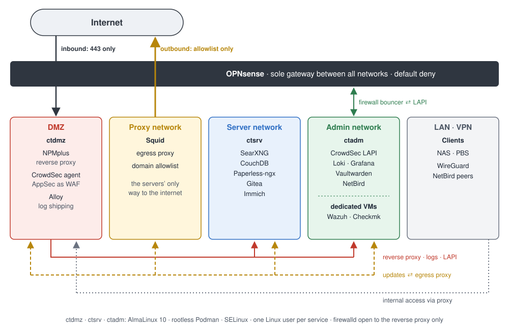

# Homelab – Security-Focused Self-Hosting

A documented homelab that I plan, build and run myself, with a focus on network segmentation, least privilege and detecting attacks early.

Each project shows what I built, why I made each decision, which trade-offs I accepted and what went wrong along the way.

> **Scope:** This is a personal learning lab running on my own hardware, not production infrastructure. Domains, IP addresses, credentials and other identifying details have been removed or replaced with placeholders.

> **How I work:** I use AI as a research tool and technical sounding board. Decisions, implementation and troubleshooting are my own. See [Working method](docs/principles.md#working-method).

## Projects

| # | Project | What it shows | Status |
|---|---|---|---|
| 01 | [Segmented homelab with Ubuntu and Docker](projects/01-ubuntu-docker.md) | Network segmentation with OPNsense based on privilege, reverse proxy with WAF, CrowdSec bans enforced at the firewall, Wazuh and Checkmk on every host, self-hosted VPN for networks that block UDP | Superseded by 02 |
| 02 | [Migration to AlmaLinux and rootless Podman](projects/02-migration-almalinux-podman.md) | Finding and fixing weaknesses in my own setup: rootless containers with SELinux, one Linux user per service, egress through a proxy with an allowlist, keys moved out of the DMZ, data migration between UID ranges without reassigning permissions | Done (Podman monitoring on two hosts pending) |
| 03 | [Local AI with Strata](projects/03-local-ai-strata.md) | A language model running on my own GPU for anything involving sensitive data, with Open WebUI as interface, web search through my own SearXNG and a knowledge base synced automatically from my Obsidian homelab notes | In progress |
| 04 | Per-host allowlists in Squid | Each server may only reach the domains it actually needs, instead of all servers sharing one allowlist | Planned |
| 05 | Notification server for bans | Self-hosted push notifications (ntfy) when CrowdSec bans an IP, so attacks are noticed right away instead of in the dashboard later | Planned |
| 06 | ClamAV with Wazuh integration | Malware scanning on the hosts, with findings reported centrally in Wazuh | Planned |

**Short on time?** Read [Project 02](projects/02-migration-almalinux-podman.md). It shows how I review a running setup, weigh trade-offs and rebuild it step by step.

## Current state

| Area | Used |
|---|---|
| Hypervisor | Proxmox VE, backups with PBS |
| Firewall & routing | OPNsense, networks on separate bridges |
| DNS | Unbound with blocklists, DNS over TLS |
| Containers | AlmaLinux 10, rootless Podman, SELinux, one Linux user per service |
| Reverse proxy | NPMplus with CrowdSec AppSec as WAF |
| Intrusion prevention | CrowdSec, central LAPI in the admin network, bans enforced at the firewall |
| Egress | Squid with a domain allowlist |
| Monitoring & SIEM | Wazuh, Checkmk, Loki + Grafana + Alloy |
| Remote access | WireGuard, NetBird (self-hosted, relay only) |

## Documentation

| Document | Contents |
|---|---|
| [Principles](docs/principles.md) | Goals and principles everything is built on |
| [Architecture](docs/architecture.md) | Hosts, networks, components |
| [Network segmentation](docs/network-segmentation.md) | Zones, allowed connections, egress |
| [Firewall policy](docs/firewall-policy.md) | How rules are structured and changed |
| [Firewall rules](examples/firewall-rules.md) | All rules per interface as pseudocode |
| [Design decisions](docs/design-decisions.md) | Architecture decisions and trade-offs |
| [Services](docs/services.md) | Which service runs where and under which user |
| [Runbooks](docs/runbooks/) | Recurring procedures, step by step |
| [Changelog](CHANGELOG.md) | Changes by date |
