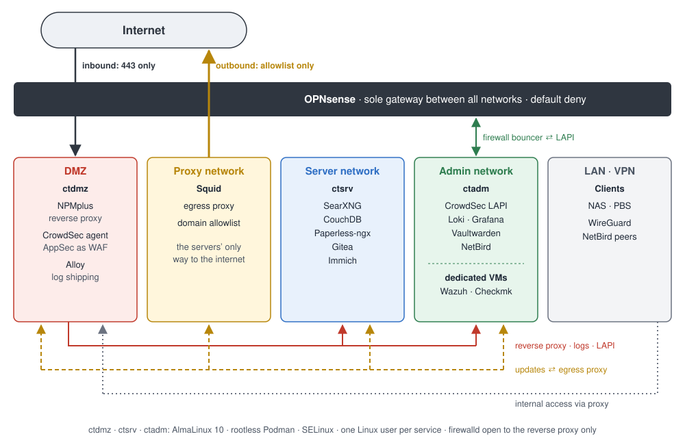

# Architecture

State as of [Project 02](../projects/02-migration-almalinux-podman.md).

## Networks

| Network | Purpose | Hosts |
|---|---|---|
| LAN | Clients, NAS, backups | Workstation, NAS, PBS, Proxmox host |
| ADM | Systems with rights over other systems | `ctadm`, Wazuh, Checkmk |
| SRV | Applications without special privileges | `ctsrv` |
| DMZ | Everything reachable directly from the internet | `ctdmz` |
| PRX | Egress proxy | Squid |
| VPN | Remote access | WireGuard on OPNsense, NetBird |

Each network is its own Proxmox bridge with its own interface in OPNsense. OPNsense is the only gateway between the networks and to the internet.

## Container hosts

All three container hosts are built the same way:

- AlmaLinux 10, SELinux in enforcing mode
- rootless Podman with `podman-compose`
- one Linux user per service, each with its own subuid and subgid range
- ports bound to the host IP, firewalld only admits the reverse proxy
- package repositories and image pulls through Squid
- Wazuh and Checkmk agents on the host

| Host | Network | Services (one user each) |
|---|---|---|
| `ctdmz` | DMZ | NPMplus with CrowdSec agent and AppSec, Alloy |
| `ctsrv` | SRV | SearXNG, CouchDB, Paperless-ngx, Gitea, Immich |
| `ctadm` | ADM | CrowdSec LAPI, Loki + Grafana, Vaultwarden, NetBird |

## Security components

**Reverse proxy:** NPMplus on `ctdmz` with a wildcard certificate via DNS-01 challenge. Internal services are only reachable from LAN and VPN through access lists. Runs in host network mode so that real client IPs reach CrowdSec and the access lists.

**CrowdSec:**
- Agent with AppSec on `ctdmz` reads the proxy logs and inspects requests as a WAF
- LAPI on `ctadm` holds the decision database, profiles and allowlist
- Firewall bouncer on OPNsense enforces bans on all ports, not just HTTP
- WAF hits lead to short bans; repeated hits within a week and detected scans lead to permanent ones
- Alerts are sent from the LAPI directly to Loki

**Monitoring and SIEM:**
- Wazuh with agents on every host, including OPNsense, Proxmox and PBS
- Checkmk for availability and resources, with Podman monitoring through the Podman API of each service user
- Security dashboard in Grafana: Alloy ships the proxy logs, CrowdSec the alerts, and Grafana queries active bans directly from the LAPI

**Remote access:** WireGuard on OPNsense for direct connections. NetBird in relay-only mode for networks that block UDP, with OPNsense as routing peer.

**DNS:** Unbound on OPNsense with blocklists, upstream via DNS over TLS, local names as host overrides.
