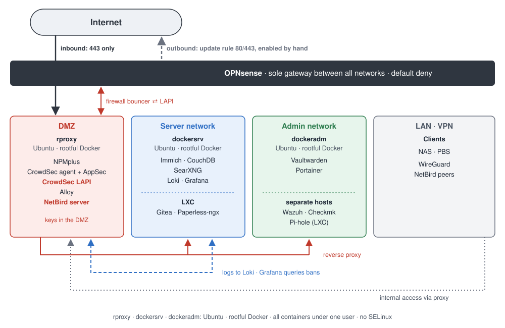

# Project 01 – Segmented Homelab with Ubuntu and Docker

**Status:** Superseded by [Project 02](02-migration-almalinux-podman.md)
**Period:** until October 2026

## Goal

A homelab for learning and self-hosting, built on the [principles](../docs/principles.md): zones based on privilege, explicit allow only, no permanent internet access for servers.

## Setup

- **Hypervisor and firewall:** Proxmox VE, OPNsense as the only gateway, each network on its own bridge.
- **Containers:** one Ubuntu VM with Docker per network.
- **Reverse proxy:** NPMplus in the DMZ with a wildcard certificate via DNS-01; internal services reachable from LAN and VPN only.
- **Intrusion prevention:** CrowdSec with a central LAPI on the reverse proxy. The firewall bouncer on OPNsense enforces bans on all ports; AppSec works as a WAF inside NPMplus.
- **Monitoring:** Wazuh with agents on every host, Checkmk, and a custom security dashboard with Loki and Grafana.
- **Egress:** No permanent internet access for servers. For updates, a rule for outbound TCP 80 and 443 that I enabled temporarily and disabled again afterwards.
- **Remote access:** WireGuard on OPNsense. My vocational school's network blocks UDP, so I added NetBird in relay-only mode over port 443. Self-hosted, so that device list, keys and access rules don't sit with a third party.

## What worked well

- Segmentation with explicit allow rules, each with source IP and port
- No server had permanent internet access
- CrowdSec bans were enforced centrally at the firewall, not only at the proxy
- Every host sent logs to Wazuh

## Weaknesses that led to Project 02

A review turned up weaknesses that network segmentation alone couldn't cover:

1. **Rootful Docker.** A container escape meant root on the VM.
2. **All services under one user.** A compromised container would have reached the others' data.
3. **Keys in the DMZ.** The NetBird server and the CrowdSec LAPI ran on the most exposed system, against my own principles.
4. **No mandatory access control.** No SELinux isolation for containers.
5. **Egress by switch.** While the update rule was active, any domain was reachable. Forgetting to disable it would have left it open permanently.
6. **False positives in Wazuh.** On Ubuntu 26.04, real findings got lost among kernel CVE reports.
